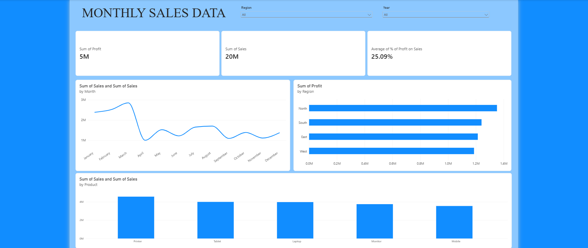

# Sales Analytics ETL Pipeline

An end-to-end Sales Data Analytics project using **Python, Pandas, MySQL, SQL, and Power BI** to clean, transform, store, analyze, and visualize sales data.

## Project Overview

This project focuses on analyzing sales data to generate meaningful business insights. It implements an ETL (Extract, Transform, Load) pipeline using Python and MySQL, followed by SQL-based analysis and interactive Power BI visualizations.

The project transforms raw sales data into a structured dataset that helps understand sales performance, customer behavior, regional performance, and product profitability.

## Business Objectives

- Analyze overall sales and order performance.
- Identify high-performing products and regions.
- Understand monthly sales trends.
- Calculate profit and evaluate profitability.
- Transform raw data into a structured format for reporting.
- Build an interactive Power BI dashboard for business decision-making.

## Technologies Used

| Technology | Purpose |
|---|---|
| Python | Data processing and ETL |
| Pandas | Data cleaning and transformation |
| Jupyter Notebook | Data analysis and execution |
| MySQL | Database storage |
| SQL | Data querying and analysis |
| SQLAlchemy | Python–MySQL connectivity |
| Power BI | Interactive dashboard and visualization |
| Excel | Raw dataset |

## Project Workflow

1. **Extract:** Load raw sales data from Excel using Pandas.
2. **Transform:** Clean and preprocess the dataset, handle data types, and calculate additional fields.
3. **Load:** Store the cleaned dataset in MySQL using SQLAlchemy.
4. **Analyze:** Perform SQL queries to extract meaningful business insights.
5. **Visualize:** Build an interactive Power BI dashboard to present sales performance.

## Project Structure

```text
Sales-Analytics-ETL-Pipeline/
│
├── data/
│   ├── raw/
│   │   └── sales_raw_500.xlsx
│   │
│   └── processed/
│       └── Sales_Cleaned_dataset.csv
│
├── notebooks/
│   └── Cleaning_Data.ipynb
│
├── powerbi/
│   └── Monthly_Sales_Data.pbix
│
├── screenshots/
│   └── dashboard.png
│
├── sql/
│   └── sales_analysis.sql
│
├── .gitignore
├── requirements.txt
└── README.md
```

## ETL Pipeline

### 1. Data Extraction and Cleaning

- Imported the raw Excel dataset using Pandas.
- Performed data cleaning and preprocessing.
- Created additional analytical columns such as Profit, Year, and Month.
- Exported the cleaned dataset as a CSV file.

### 2. MySQL Database Integration

- Connected Python to MySQL using SQLAlchemy and PyMySQL.
- Used environment variables to protect database credentials.
- Loaded the cleaned dataset into the `salesdb` database.
- Stored the data in the `sales_data` table.

### 3. SQL Analysis

Performed SQL-based analysis to explore sales performance, including:

- Total sales and profit.
- Monthly sales trends.
- Regional sales performance.
- Product-wise sales analysis.
- Order and customer analysis.

### 4. Power BI Dashboard

Developed a Power BI dashboard to visualize sales performance and business insights through interactive charts and visualizations.

## Dashboard Preview



*Add your Power BI dashboard screenshot inside the `screenshots` folder and name it `dashboard.png`.*

## Installation and Setup

### Prerequisites

- Python 3.12+
- MySQL Server
- Jupyter Notebook
- Power BI Desktop
- Git

### Step 1: Clone the repository

```bash
git clone https://github.com/PremjitDas/Sales-Analytics-ETL-Pipeline.git
```

```bash
cd Sales-Analytics-ETL-Pipeline
```

### Step 2: Install dependencies

```bash
pip install -r requirements.txt
```

### Step 3: Configure environment variables

Create a `.env` file in the project root directory:

```ini
MYSQL_PASSWORD=your_mysql_password
```

Never upload your actual `.env` file to GitHub.

### Step 4: Configure MySQL

Create the database in MySQL:

```sql
CREATE DATABASE salesdb;
```

### Step 5: Run the ETL pipeline

Open the Jupyter Notebook:

```bash
jupyter notebook
```

Open `notebooks/Cleaning_Data.ipynb` and execute the cells to clean the dataset and load it into MySQL.

### Step 6: Run SQL analysis

Execute the queries available in:

```text
sql/sales_analysis.sql
```

### Step 7: Open the Power BI dashboard

Open the `.pbix` file available inside the `powerbi` folder using Power BI Desktop.

## Key Outcomes

- Successfully implemented an end-to-end ETL pipeline.
- Cleaned and transformed 482 sales records.
- Integrated Python with MySQL.
- Stored processed data in a relational database.
- Performed SQL-based business analysis.


*This project was developed as a hands-on Data Analytics portfolio project to demonstrate practical skills in data cleaning, ETL development, database management, SQL analysis, and business intelligence.*
